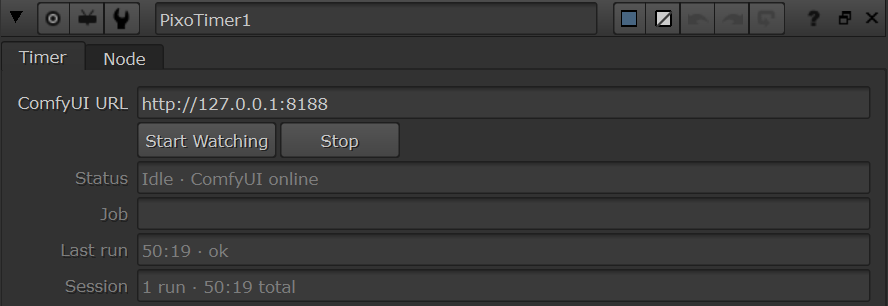
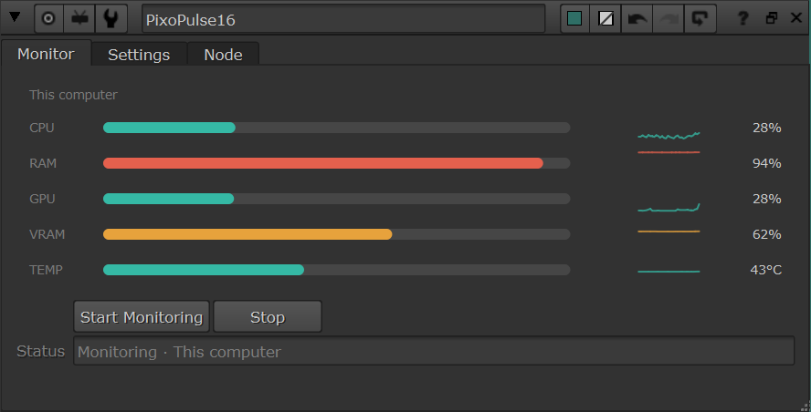

# Pixo for Nuke

A run timer and a live system monitor for ComfyUI, as two gizmos inside Nuke. See how long every ComfyUI job takes, and watch CPU, RAM, GPU, VRAM and temperature without leaving Nuke. No ComfyUI custom nodes and no extra Python packages are needed.

Made by **[Omar El Sharkawy](https://github.com/OmarSharkawyy)**.

| Gizmo | What it does |
| --- | --- |
| **Pixo Timer** | Times any job ComfyUI runs, including jobs started from the ComfyUI web page or other tools. |
| **Pixo Pulse** | Live CPU, RAM, GPU, VRAM and GPU temperature meters, each with the last minute drawn beside it. |

## Install

1. Download `Pixo-Nuke.zip` from the [latest release](https://github.com/OmarSharkawyy/Pixo-Nuke/releases/latest), or the repository from **Code → Download ZIP**, and extract it. Both give a folder named `Pixo-Nuke-main`. Put it inside your `.nuke` folder:
   - Windows: `%USERPROFILE%\.nuke`
   - macOS and Linux: `~/.nuke`
2. Open or create `init.py` in that `.nuke` folder and add these lines, keeping any existing startup code:

   ```python
   import nuke
   nuke.pluginAddPath("./Pixo-Nuke-main")
   ```

   If you used `git clone` instead of the ZIP, the folder is called `Pixo-Nuke`, so write `./Pixo-Nuke` instead.
3. Restart Nuke. Pixo has its own **Pixo** menu, both in the Nodes toolbar on the left and in the menu bar at the top, with *Timer* and *Pulse*.

The folder you point at must be the one that directly contains `menu.py` and the two `.gizmo` files, not a folder one level above it. ZIP extractors sometimes add an extra folder, so check.

If you installed the older `comfyui-run-timer-nuke` or `comfypulse-nuke` folder, delete it and its `pluginAddPath` line. Pixo replaces both.

To uninstall, delete the folder and its line in `init.py`. Pixo nodes already in a script will show as missing until the folder is back.

Requires Nuke with Python 3 (developed against Nuke 16). The meters use PySide, which Nuke includes.

## Troubleshooting

| Problem | What to check |
| --- | --- |
| No **Pixo** menu | `pluginAddPath` must point at the folder that contains `menu.py`, and Nuke must be restarted after you edit `init.py`. Look for **Pixo** in the menu bar at the top, or in the Nodes toolbar on the left. |
| Pixo is not found when I press Tab | Use the menu above. Tab search lists menu items, so Pixo appears there too once the menu exists. |
| An error when I click Timer or Pulse | Open the Script Editor and look at the message there. It names the file and line that failed. Send it along when you report a problem. |
| The meter panel says it could not load | The panel prints the reason. The node still works, and the label on the node shows the readings. |
| `ComfyUI offline · retrying` | Open the **ComfyUI URL** in a browser. It must be the address of the server, such as `http://127.0.0.1:8188`. |
| `Stopped: ... HTTP 404` | That URL answers, but it is not a ComfyUI server. Check the address and port. |
| GPU, VRAM or temperature show `n/a` | These need an NVIDIA GPU and `nvidia-smi` (installed with the driver). Try running `nvidia-smi` in a terminal. |
| Meters stay empty | Press **Start Monitoring**. The panel only fills while it is running. |
| It stopped after I reopened the script | Watching never restarts by itself. Press Start again. |

## Pixo Timer



1. Create the node and check **ComfyUI URL** (default `http://127.0.0.1:8188`).
2. Click **Start Watching**. Click **Stop** to end it.
3. Run anything in ComfyUI.

The panel shows `Idle`, `Running · 02:31` or `ComfyUI offline · retrying`, the running job's short id, the last finished run (`ok`, `failed`, `stopped`) and the runs and total time since you started. The node's label in the Node Graph shows the timer too.

How the timing works:

- The server is polled every 2 seconds and the display refreshes every second.
- **Last run** uses ComfyUI's own start and finish timestamps, so it is exact.
- A job that was already running when you pressed Start Watching is shown as a lower bound (`≥02:31`) until it finishes.
- If ComfyUI cannot be reached for a moment, a running timer keeps counting and shows `connection lost`.
- A URL that answers with an error such as HTTP 404 is not treated as ComfyUI: watching stops with a message.
- Time spent waiting in the queue is not included. The queue gives no per-node progress, so this shows time, not a percentage.

## Pixo Pulse



1. Create the node, open the **Monitor** tab, and click **Start Monitoring**. Click **Stop** to end it.
2. The node's label in the Node Graph shows a short readout such as `CPU 31 · GPU 17 · RAM 75`.

Meters turn amber at 60% (65 °C for temperature) and red at 85% (80 °C). Hover the panel for details such as `9.1 / 12.0 GB`.

**Settings tab**

- **Read from**: *Auto* reads this computer when the ComfyUI URL points at this machine and the ComfyUI server otherwise. *Local* and *Server* force one or the other.
- **GPU number**: which graphics card to read when the computer has more than one. 0 is the first card, 1 the second, and so on. With a single card, leave it at 0. To see each card's number, run `nvidia-smi -L` in a terminal; it lists them as `GPU 0`, `GPU 1`, and so on. A number higher than the last card reads the last card. With *Read from* set to *Server*, the number counts the cards in the list ComfyUI reports.

What each source can report:

| Reading | This computer | ComfyUI server (other machine) |
| --- | --- | --- |
| CPU | yes | no |
| RAM | yes | yes, ComfyUI's view |
| GPU load | NVIDIA only | no |
| VRAM | NVIDIA, otherwise taken from ComfyUI | yes |
| GPU temperature | NVIDIA only | no |

NVIDIA readings come from `nvidia-smi`, which is installed with the NVIDIA driver. On AMD or Intel graphics, or without the driver, those rows show `n/a`. If `nvidia-smi` keeps failing it is left alone for 30 seconds before the next try. CPU and RAM use `psutil` when it is available and otherwise read Windows or Linux directly.

Updating a gizmo's display never marks your script as modified.

## Tests

```
python3 -I tests/smoke.py
```

They use a fake clock, local HTTP servers standing in for ComfyUI, scripts standing in for `nvidia-smi`, and a stand-in for Nuke. The meter panel is drawn offscreen and its pixels are checked (skipped if PySide is not installed). Nuke, ComfyUI and a GPU are not needed.

## Checked in Nuke

The automated tests run without Nuke. Everything they cannot reach was checked inside Nuke 16.0v5 on Windows 11 with an NVIDIA GPU: both gizmos load, the *Read from* drop-down offers Auto, Local and Server, a display update leaves the script unmodified, the CPU, RAM, GPU, VRAM and temperature readings come back from this computer, and the meter panel draws and updates inside Nuke's Properties panel while monitoring.

## License

MIT © 2026 Omar El Sharkawy. You may use, change and share Pixo freely, as long as the copyright notice and the [LICENSE](LICENSE) stay with every copy.
